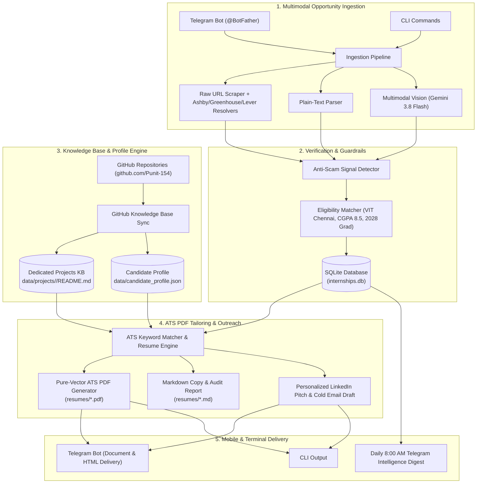

# ?? AI-Powered Internship Intelligence & Automated Application Assistant

A production-grade, zero-fabrication personal internship intelligence system built for Computer Science engineering students. Seamlessly ingests opportunities from Telegram, job links, and screenshots, verifies job authenticity against ATS portals, dynamically tailors ATS-compliant pure vector PDF resumes using your real GitHub repositories, and tracks application lifecycles from application to offer.

---

## ??? System Architecture



---

## ?? Key Capabilities

### 1. Multimodal Opportunity Ingestion
- **Direct Link Ingestion**: Scrapes and resolves direct ATS portals (Ashby, Greenhouse, Lever, Workday) and company career sites.
- **Screenshot & Photo Extraction**: Upload camera captures, Instagram flyers, or PDF notices. Google Gemini 3.8 Flash extracts role, company, stipend, graduation year eligibility, and deadlines.
- **Search Grounding & Fallback**: If an image lacks an application link, the assistant uses live DuckDuckGo grounding to discover the authentic career portal URL.

### 2. Zero-Fabrication Candidate Profile Engine
- **Dedicated Project Knowledge Base**: Every portfolio project stores its full remote `README.md` and metadata under `data/projects/<slug>/`.
- **Automatic GitHub Sync & Deduplication**: Ingests directly from GitHub URLs (`https://github.com/Punit-154/Reco.ai`). If a project already exists, updates it in place with the latest README without creating duplicate entries.
- **Strict Verification**: Only skills and quantifiable metrics proven in your projects and resume are ever included. No hallucinated experiences.

### 3. Truthful Pure-Vector ATS PDF Resume Generator
- **No LaTeX Dependencies**: Compiles directly into high-fidelity, single-page vector PDFs (`.pdf`) using standard Type-1 Helvetica fonts.
- **Clean ATS Compatibility**: Fully parseable by ATS scanners with selectable text, structured standard headings (`EDUCATION`, `TECHNICAL SKILLS`, `SELECTED PROJECTS`), and dynamic contact headers (Email, Phone, LinkedIn, GitHub, Portfolio).
- **ATS Keyword Audit**: Measures keyword overlap, reports matched keywords and omitted skill gaps with exact match percentages.
- **Companion Outreach Drafts**: Automatically generates personalized LinkedIn referral pitches and cold email drafts targeted to recruiters and alumni.

### 4. Application Lifecycle Tracking & Approaching Deadlines
- **Full State Machine**: Track applications through `NEW` ? `APPLIED` ? `INTERVIEWING` ? `OFFER` ? `REJECTED` ? `ARCHIVED`.
- **Interactive Telegram UI**: Quick-action inline keyboard buttons to update status, tailor resumes, or view application portals in one tap.
- **Deadline Monitoring**: View closing opportunities (`/deadlines`) with urgency badges (`?? CLOSING TODAY`, `?? 2d left`).

### 5. Automated Daily Intelligence Briefing
- **Scheduled Digest**: Delivers an 8:00 AM morning executive summary directly to your private Telegram chat.
- **Curated Insights**: Highlights top-matching new opportunities, active interview pipelines, and urgent deadlines.

---

## ?? Project Structure

```
ai-internship-assistant/
??? data/
?   ??? candidate_profile.json     # Punit's verified profile, skills, and contact info
?   ??? projects/                  # Dedicated project knowledge base
?       ??? reco-ai-.../           # Raw README.md & project.json
?       ??? rag-q-a-.../           # Raw README.md & project.json
?       ??? specvault-.../         # Raw README.md & project.json
?       ??? auto-scaling-.../      # Raw README.md & project.json
?       ??? blackbox-parser-.../   # Raw README.md & project.json
??? resumes/                       # Generated ATS vector PDFs & companion markdown
?   ??? Resume_InterviewKickstart_Job8.pdf
?   ??? Resume_InterviewKickstart_Job8.md
??? src/
?   ??? config.py                  # Environment settings & Pydantic validation
?   ??? database.py                # SQLModel SQLite database engine
?   ??? interfaces/
?   ?   ??? bot.py                 # Telegram bot handlers & inline keyboards
?   ?   ??? cli.py                 # Command-line interface
?   ??? models/
?   ?   ??? candidate.py           # Candidate profile & project models
?   ?   ??? job.py                 # Job posting & audit models
?   ??? services/
?       ??? digest.py              # Morning intelligence digest generator
?       ??? extractor.py           # Gemini 3.8 Flash structured extractor
?       ??? github_service.py      # GitHub README fetcher & KB persistence
?       ??? pdf_generator.py       # Pure-vector Type-1 ATS PDF generator
?       ??? pipeline.py            # End-to-end ingestion orchestrator
?       ??? profile.py             # Profile scoring & deduplication logic
?       ??? resume.py              # ATS keyword audit & resume tailorer
?       ??? scraper.py             # HTTPX scraper & ATS resolver
?       ??? verifier.py            # Anti-scam heuristics & search grounding
??? tests/                         # Comprehensive pytest test suite (68 tests)
??? .env                           # Local environment credentials (ignored by git)
??? .env.example                   # Environment configuration template
??? internships.db                 # SQLite database storage
??? requirements.txt               # Production dependencies
```

---

## ? Quickstart Guide

### 1. Prerequisites
- Python 3.11+
- [Telegram Bot Token](https://t.me/BotFather) from BotFather
- [Google Gemini API Key](https://aistudio.google.com/) (Free Tier)

### 2. Installation
Clone the repository and set up a virtual environment:

```bash
git clone https://github.com/Punit-154/ai-internship-assistant.git
cd ai-internship-assistant

# Create and activate virtual environment
python -m venv .venv

# Windows:
.\.venv\Scriptsctivate
# Linux/macOS:
source .venv/bin/activate

# Install dependencies
pip install -r requirements.txt
```

### 3. Environment Configuration
Copy the template and configure your secrets:

```bash
cp .env.example .env
```

Edit `.env`:
```env
GEMINI_API_KEY=your_gemini_api_key_here
TELEGRAM_BOT_TOKEN=your_telegram_bot_token_here
TELEGRAM_ALLOWED_USER_ID=your_numeric_telegram_user_id
DATABASE_URL=REDACTED
```

> **Note:** To find your Telegram user ID, send `/start` to `@userinfobot` on Telegram.

### 4. Initialize Database
```bash
python -m src.interfaces.cli init-db
```

---

## ?? CLI Reference

The assistant includes a full-featured CLI for terminal workflows:

| Command | Description | Example |
|---|---|---|
| `init-db` | Initializes SQLite schema and tables | `python -m src.interfaces.cli init-db` |
| `show-profile` | Displays verified skills, academic details, and projects | `python -m src.interfaces.cli show-profile` |
| `update-profile` | Updates specific profile attributes | `python -m src.interfaces.cli update-profile --key cgpa --value "9.22"` |
| `add-project` | Ingests project from GitHub URL or text snippet | `python -m src.interfaces.cli add-project https://github.com/Punit-154/Reco.ai` |
| `extract-url` | Scrapes and extracts an opportunity from a URL | `python -m src.interfaces.cli extract-url "https://jobs.lever.co/company/role"` |
| `extract-text` | Ingests raw job description text | `python -m src.interfaces.cli extract-text "Looking for SWE intern..."` |
| `extract-image` | Extracts opportunity from screenshot or PDF | `python -m src.interfaces.cli extract-image path/to/flyer.png` |
| `list-jobs` | Lists stored opportunities with filter options | `python -m src.interfaces.cli list-jobs --limit 10` |
| `status` | Updates application tracking state | `python -m src.interfaces.cli status 8 applied --notes "Applied via portal"` |
| `deadlines` | Lists upcoming deadlines within N days | `python -m src.interfaces.cli deadlines --days 7` |
| `digest` | Generates the daily intelligence briefing | `python -m src.interfaces.cli digest` |
| `tailor` | Generates ATS vector PDF resume and pitch for a job | `python -m src.interfaces.cli tailor 8` |
| `run-bot` | Starts the Telegram Bot long-polling daemon | `python -m src.interfaces.cli run-bot` |

---

## ?? Telegram Bot Commands & Mobile Workflow

| Command | Usage | Description |
|---|---|---|
| `/start` | `/start` | Displays welcome overview and system status |
| `/help` | `/help` | Complete cheat sheet of commands and tips |
| `/profile` | `/profile` | Shows verified skills, graduation year, CGPA, and portfolio |
| `/addproject` | `/addproject <url>` | Syncs a GitHub project README and auto-adds new skills |
| `/list` | `/list` | Displays the 10 most recently tracked opportunities |
| `/status` | `/status <id> <status>` | Updates status (`applied`, `interviewing`, `offer`, `rejected`) |
| `/deadlines` | `/deadlines [days]` | Alerts on deadlines approaching in the next 7?14 days |
| `/digest` | `/digest` | Generates and sends today's intelligence summary on demand |
| `/tailor` | `/tailor <id>` | Tailors an ATS vector PDF resume and delivers it to your chat |

### Direct Mobile Ingestion
- **Send any URL**: Simply paste a job link into Telegram. The bot resolves the ATS, extracts requirements, checks eligibility, and replies with an interactive card.
- **Send any Screenshot / Flyer**: Send an image or photo. Gemini 3.8 Flash extracts the role details, discovers application URLs via DuckDuckGo if missing, and saves the job.
- **Forward announcements**: Forward text posts from university WhatsApp/Telegram channels directly into the bot.

---

## ?? 24/7 Long-Term Daemon Setup

Run the Telegram Bot continuously in the background on your workstation or VPS:

### Option A: Using PM2 (Recommended)
```bash
npm install -g pm2
pm2 start "python -m src.interfaces.cli run-bot" --name "internship-bot"
pm2 save
pm2 startup
```

### Option B: Windows Task Scheduler / Background PowerShell
Run in a detached background process:
```powershell
Start-Process -NoNewWindow -FilePath ".\.venv\Scripts\python.exe" -ArgumentList "-m src.interfaces.cli run-bot"
```

### Option C: Linux systemd Service
Create `/etc/systemd/system/internship-bot.service`:
```ini
[Unit]
Description=AI Internship Intelligence Telegram Bot
After=network.target

[Service]
Type=simple
User=punit
WorkingDirectory=/path/to/ai-internship-assistant
ExecStart=/path/to/ai-internship-assistant/.venv/bin/python -m src.interfaces.cli run-bot
Restart=always
RestartSec=10

[Install]
WantedBy=multi-user.target
```
Enable and start the service:
```bash
sudo systemctl daemon-reload
sudo systemctl enable internship-bot
sudo systemctl start internship-bot
```

---

## ?? Test Suite

Run the full automated test suite covering all modules:

```bash
pytest -v
```

**Results:**
```
============================= test session starts =============================
collected 68 items

tests/test_bot.py .......                                                [ 10%]
tests/test_config.py ..                                                  [ 13%]
tests/test_database.py ......                                            [ 22%]
tests/test_digest.py ..                                                  [ 25%]
tests/test_extractor.py ...                                              [ 29%]
tests/test_github_service.py ....                                        [ 35%]
tests/test_models.py ..                                                  [ 38%]
tests/test_multimodal.py ......                                          [ 47%]
tests/test_pdf_generator.py ...                                          [ 51%]
tests/test_pipeline.py ......                                            [ 60%]
tests/test_profile.py .........                                          [ 73%]
tests/test_resume.py ...                                                 [ 77%]
tests/test_scraper.py ....                                               [ 83%]
tests/test_status_tracking.py .....                                      [ 91%]
tests/test_verifier.py ......                                            [100%]

============================== 68 passed in 3.8s ==============================
```

---

## ??? License & Ethics

Built for ethical, truthful career assistance:
- **Zero Fabrication Guarantee**: The system will never hallucinate or invent skills or projects.
- **Strict Privacy**: Your candidate profile, resumes, and database remain 100% local on your device.
- **$0.00 Operational Cost**: Optimized to run fully within Google Gemini Flash and Telegram Bot API free tiers.
